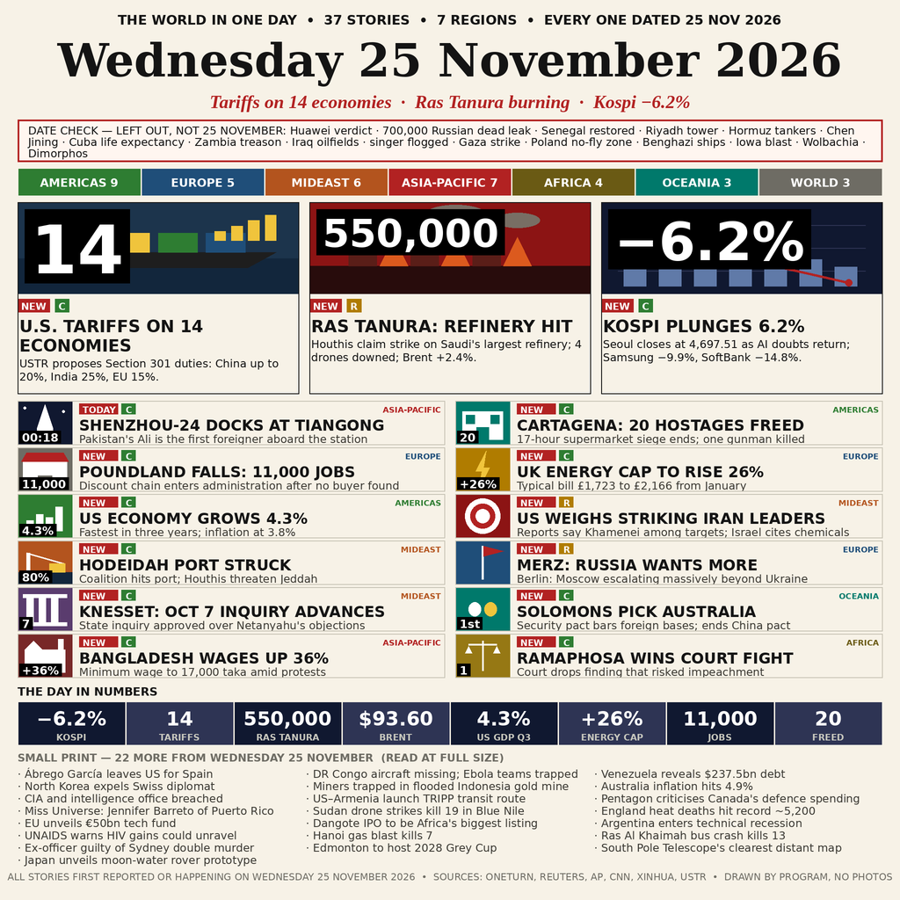

# news-image-20261125 — The World in One Day (V1, ATM)

[](https://make.fun/bounty/news-image-20261125?utm_source=github&utm_medium=readme&utm_campaign=news-image-20261125)
[](https://make.fun/bounty/news-image-20261125/leaderboard?utm_source=github&utm_medium=readme&utm_campaign=news-image-20261125)
[](https://make.fun/bounty/news-image-20261125?utm_source=github&utm_medium=readme&utm_campaign=news-image-20261125)



**Sum up Wednesday 25 November 2026 in one image.** 37 stories, 7 regions,
every one dated Wednesday 25 November 2026 (UTC).

## What the picture shows

- **THREE SHOCKS, drawn big:** U.S. tariffs on 14 economies (USTR Section 301
  proposal — China up to 20%, India 25%, EU 15%) · Ras Tanura refinery hit
  (Houthis claim the strike on Saudi Arabia's largest refinery, 550,000
  barrels/day; 4 drones downed; Brent +2.4%) · Kospi plunges 6.2% (Seoul
  closes at 4,697.51 as AI doubts return).
- **THE DAY IN TWELVE, two columns wide:** Shenzhou-24 docks at Tiangong
  (Pakistan's Ali, first foreigner aboard) · Cartagena: 20 hostages freed ·
  Poundland falls, 11,000 jobs at risk · UK energy cap to rise 26% · US
  economy grows 4.3% · US weighs striking Iran's leaders · Hodeidah port
  struck · Merz: Russia wants more · Knesset: Oct 7 inquiry advances ·
  Solomons pick Australia · Bangladesh wages up 36% · Ramaphosa wins his
  court fight. Every card says what is NEW today or what happened TODAY,
  with a C/R/CL evidence tag.
- **THE DAY IN NUMBERS:** Kospi −6.2% · 14 tariff economies · 550,000 bpd ·
  $93.60 Brent · 4.3% US GDP · +26% UK energy cap · 11,000 jobs · 20 hostages.
- **DATE CHECK:** 16 items left out because they happened or were first
  reported before Wednesday — the Huawei verdict, the leaked 700,000 Russian
  dead, Senegal restored, the Riyadh tower strike, the Hormuz tankers, Chen
  Jining, Cuba's life expectancy, Zambia's treason charge, Iraq's oilfields,
  the flogged singer, the Gaza strike, Poland's no-fly zone, the Benghazi
  ships, the Iowa blast, Wolbachia, Dimorphos.
- **SMALL PRINT:** 22 more stories, labelled as small print and readable at
  full size.

## How it is made

`render.py` draws the whole front page procedurally with Pillow — no
external assets, no network, no clock, no randomness. `main.py` copies the
rendered `entry.png` to the output directory the grader names, so two runs
write identical bytes.

```sh
python3 render.py   # draw the picture (1024x1024, < 1 MiB)
python3 main.py     # place it in $MAKEFUN_OUTPUT_DIR/entry.png
```

## Sources

OneTurn day page for 25 Nov 2026 (97 stories from 925 headlines), cross-checked
by web search on 25 Nov for the Kospi close, the Shenzhou-24 launch and docking
times, the USTR tariff announcement, the Ras Tanura claim and the Hodeidah
strike. Scenes are drawn illustrations of reported events, not photographs.
